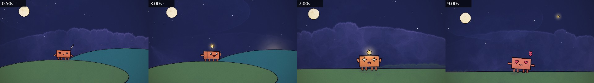

# Painted Animation · Codex Skill

用代码制作水彩、墨线风格的二维动画、音乐 MV 和歌词视频。

A Codex skill for code-rendered watercolor-and-ink animation, character acting and lyric videos. It combines p5.js, p5.brush, headless Chrome and FFmpeg. This is a community adaptation, not an official OpenAI or Anthropic product.



上图为上游内置示例，用于验证基础渲染链路，不是用户的歌曲 MV。

## 适合做什么

- 手绘感短片、角色动画、MV、歌词视频和循环动画。
- 歌词与场景共用时间表，关键动作对应实际唱词。
- 情绪变化、角色互动、依偎等接触动作与逐帧检查。
- 根据画面留白设计手写歌词，而不是一律套底部字幕。
- 检查转场两端、字体加载、字幕遮挡，以及最终视频的音画完整性。

不适合写实视频生成或普通素材剪辑。它不是“一句话自动生成完美视频”的模型，也不包含音频转写模型、歌曲或商用素材。

## 安装到项目

下载本仓库后，将 `skills/painted-animation` **整个文件夹**复制到你的项目：

```text
你的项目/
└── .agents/skills/painted-animation/
    ├── SKILL.md
    ├── agents/
    ├── references/
    ├── scripts/
    ├── examples/
    └── template/
```

不要只复制 `SKILL.md`。如果已有同名技能，请先备份或比较，避免覆盖自己的修改。也可以让 Codex 的 `$skill-installer` 从本 GitHub 仓库安装 `skills/painted-animation`。

在 Codex 中调用 `$painted-animation`；如果界面使用技能选择器，则选中 Painted Animation。新安装未出现时，重新打开 Codex。安装位置与发现机制见 [OpenAI 官方技能说明](https://learn.chatgpt.com/docs/build-skills)。

## 运行环境

| 依赖 | 用途 |
|---|---|
| Node.js + npm | 安装模板依赖和运行渲染器；本地验证使用 Node.js 24 |
| Chrome / Chromium | 无界面画面渲染，可用 `CHROME_PATH` 或渲染器 `--chrome=` 指定 |
| FFmpeg | 编码 MP4、合入音乐，可用 `FFMPEG_PATH` 指定 |
| Python + NumPy（可选） | 节拍分析，不等于歌词自动对齐 |

依赖安装需要访问 npm。模板的手写字体默认由 Google Fonts 加载；离线使用时应保存具有合适许可的字体到项目 `assets/fonts/`，修改 `@font-face` 并验证加载。不能把缺字或普通字体回退当作正常结果。

不内置 Node、Chrome、FFmpeg、Python、模型权重或字体。可使用系统工具，也支持项目祖先目录中的 `video-tools/runtime/` 便携工具。不要把工具安装到本技能源码中。

## 快速开始

下列命令在本仓库根目录执行：

```sh
node skills/painted-animation/scripts/new_project.mjs ./my-animation
cd my-animation
```

脚手架默认停用示例场景，避免把示例当作你的作品。要验证内置示例，可另建测试项目：

```sh
node skills/painted-animation/scripts/new_project.mjs ./demo-animation --keep-demo
cd demo-animation
node render.mjs --sheet=0.5,3,7,9 --out=out/check/demo.jpg
node render.mjs --clip --fps=12 --out=out/demo.mp4
```

已有依赖管理流程时可加 `--skip-install`，之后在生成项目中运行 `npm ci`。手工制作请先读生成项目的 `ANIMATION_GUIDE.md`，写分镜、实现场景，并检查关键帧后再渲染。

长片或修改版本使用独立帧目录，避免复用旧画面：

```sh
node render.mjs --frames --fps=12 --workers=4 --frames-dir=out/frames-v1
node render.mjs --encode --fps=12 --frames-dir=out/frames-v1 --audio=assets/song.m4a --out=out/video-v1.mp4
```

两步的帧率与帧目录必须一致。没有音频时省略 `--audio`。`assets/song.m4a` 由用户自行提供，本仓库不提供歌曲。

## 给 Codex 的请求示例

> 使用 $painted-animation，将我提供歌曲的指定时间段制作成手绘 MV。先对齐歌词时间，给出分镜；歌词使用贴合画风的手写字体，按留白排版。情绪转折要有不同表情，每个接缝都检查转场。不要上传我的音频。

没有 LRC 时，技能会先检查可用的本地对齐工具；需要模型下载或无法可靠定位时会说明，不会根据节拍假装获得逐字时间。自动对齐尤其容易受伴奏和拖音影响，最终仍需复核。

## 仓库结构与检查

- [技能入口](skills/painted-animation/SKILL.md)
- [歌词对时、角色表演与排版规范](skills/painted-animation/references/lyric-direction.md)
- [音乐视频工作流](skills/painted-animation/references/music-video.md)
- `template/`：渲染模板及角色引擎。
- `examples/`：上游示例代码，不包含示例歌曲。

```sh
node scripts/validate.mjs
```

此检查覆盖发布结构、许可证、JavaScript 语法及明显不应上传的文件；不代替实际渲染或人工视觉检查。

## 来源、许可与隐私

本项目基于 [tuzhechen2005/opus-video-skills](https://github.com/tuzhechen2005/opus-video-skills) 及其采用的 John Heibel 动画模板，保留 MIT 许可证和原作者声明，详见 [NOTICE.md](NOTICE.md)。本版本主要增加 Codex 工作流适配、歌词导演规范及发布可移植性修正，不将上游引擎宣称为原创。

代码许可不授予歌曲、歌词、肖像或字体的使用权；请为自己的输入素材确认相应权限。发布包不含制作项目、个人路径、账号凭据、模型缓存或成片。发布到 GitHub 不等于上架任何官方插件市场。
